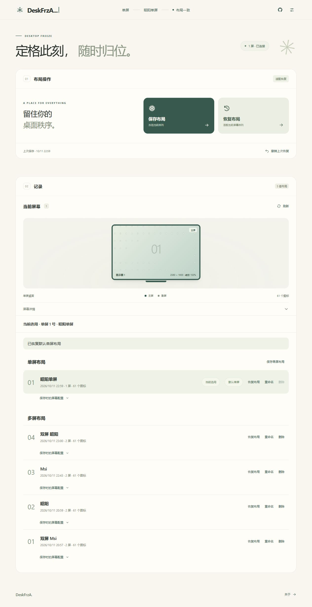

# DeskFrzA

**定格此刻，随时归位。**  
现代、极简的 Windows 桌面图标布局记忆与多屏恢复工具。

[**中文**](README.md) | [**English**](README_EN.md)

[-blue)](https://github.com/flackoye/DeskFrzA/releases)

[**下载安装版**](https://github.com/flackoye/DeskFrzA/releases/latest/download/DeskFrzA-Setup.exe) · [**下载便携版**](https://github.com/flackoye/DeskFrzA/releases/latest/download/DeskFrzA-Portable-win-x64.zip) · [**所有版本**](https://github.com/flackoye/DeskFrzA/releases)

---

## 为什么需要 DeskFrzA？

插拔外接显示器、切换主副屏或分辨率变化后，精心摆好的桌面图标常常被系统瞬间打乱。

**DeskFrzA** 像 DesktopOK 一样只专注做好“桌面图标记忆与恢复”这一件事，但带来了更现代的界面与更省心的多屏适配体验：

- 🧊 **一键定格与归位**：记录当前桌面图标位置，打乱后随时一键恢复。
- 🖥️ **懂你的多屏切换**：单屏、双屏、多屏布局分类保存；切换主副屏或更换显示器时，支持**跨屏迁移预览**与等比自适应。
- 💻 **拔屏自动恢复**：断开外接显示器回到单屏时，自动切换回你设定的**默认单屏布局**。
- 🛡️ **安全无损、可撤销**：恢复时自动保留桌面新增文件并避让冲突；每次恢复前自动备份，随时可**撤销上次恢复**。
- 🍃 **纯粹、轻量、本地化**：无广告、无多余功能，所有布局数据仅保存在本机。

  

## 下载与安装

| 版本 | 说明 | 下载链接 |
| :--- | :--- | :--- |
| **安装版 (Setup)** | 支持自定义路径、桌面快捷方式及应用内一键更新 | [DeskFrzA-Setup.exe](https://github.com/flackoye/DeskFrzA/releases/latest/download/DeskFrzA-Setup.exe) |
| **便携版 (Portable)** | 解压即用，直接运行 `DeskFrzA.exe` | [DeskFrzA-Portable-win-x64.zip](https://github.com/flackoye/DeskFrzA/releases/latest/download/DeskFrzA-Portable-win-x64.zip) |

> 查看版本说明和历史下载，请前往 [Releases 页面](https://github.com/flackoye/DeskFrzA/releases)。

## 快速上手

1. **存布局**：打开后直接点击 **保存布局**，单屏、多屏都可使用，无需先设置默认模板。
2. **恢复**：在记录列表中点击 **恢复布局**，确认后回到保存的位置；新增图标保留。
3. **按需挂载**：需要长期监测时打开右上角 GitHub 左侧的小开关；默认关闭，选择会记忆。需要单屏自动保护时，可另外将一套单屏记录设为默认。

## 使用须知

- **系统要求**：Windows 10 (1809+) / Windows 11 x64。如提示缺少运行库，请安装微软官方 [WebView2 Runtime](https://developer.microsoft.com/en-us/microsoft-edge/webview2/)。
- **默认手动使用**：后台挂载默认关闭，窗口 X 完全退出。开关位于 GitHub 图标左侧，无文字标签，悬停可查看当前状态，选择保存在本地。
- **可选后台运行**：开启后窗口 X 隐藏到系统托盘；图标变动通过 Windows 系统横幅提醒，点击通知才打开处理界面。双击托盘可打开，右键“退出”完全结束。
- **自动恢复**：需要开启后台挂载并自行选择默认单屏记录；保存一条单屏记录不会自动设为默认。开启开关时保留当前桌面，后续接屏/拔屏或以开启状态重新启动时按原规则保护。
- **后台开销**：开启后台时隐藏或最小化持续两秒后释放网页界面，后台保护继续运行；重新打开时加载已保存状态。
- **行为边界**：恢复图标不会修改你的 Windows 主显示器设置、缩放比例或图标大小。
- **数据隐私**：布局存储于本地 `%LOCALAPPDATA%\DeskFrz`，卸载应用默认保留历史布局记录。

## 文档与开发

- [恢复与迁移规则说明](docs/RESTORE.md)
- [本地构建与发布指南](docs/DEVELOPMENT.md)
- [多屏场景验证记录](docs/VALIDATION.md)
- [Windows 人工验收方案](docs/ACCEPTANCE.md)

基于 .NET 8 与原生前端构建，采用 [MIT License](LICENSE) 开源。
