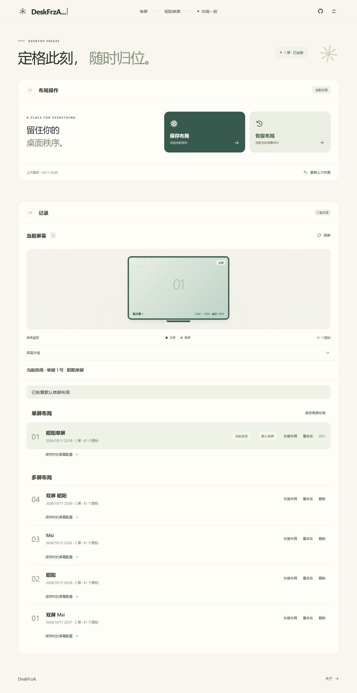

# DeskFrzA

**摆脱桌面被打乱后狼狈的手动复原。**

🧊 精心摆好的桌面被系统重新排列？DeskFrzA 帮你记录布局，随时恢复熟悉的桌面。

🖥️ 双屏、多屏下的不同排列都能分别保存。切换主屏幕后，也能恢复你想用的那套布局。

💻 断开外接显示器、回到单屏时，DeskFrzA 会自动恢复默认单屏布局，让桌面继续保持井然有序。

当前版本：**0.1.14 预览版**。

## 下载

- [Windows 安装版](https://github.com/flackoye/DeskFrzA/releases/latest/download/DeskFrzA-Setup.exe)
- [Windows 便携版](https://github.com/flackoye/DeskFrzA/releases/latest/download/DeskFrzA-Portable-win-x64.zip)
- [所有 Releases](https://github.com/flackoye/DeskFrzA/releases)

安装版可选择安装目录、创建桌面快捷方式；便携版解压后运行 `DeskFrzA.exe`。
下载链接在发布 Release 后生效；预发布版本请到“所有 Releases”下载。

## 快速使用

1. 首次打开，选择或保存一套 **默认单屏布局**。
2. 整理好桌面，点击 **保存布局**。
3. 在记录中点击 **恢复布局**；需要换屏时，确认迁移预览。

单屏、多屏记录分组显示，支持重命名和删除。恢复前自动备份，可 **撤销上次恢复**。

## 使用须知

- 支持 Windows 10 1703+ / Windows 11，x64。
- 拔屏自动恢复需要应用运行；再次打开应用时也会检查单屏状态。
- 恢复图标布局不会自动切换 Windows 主屏幕。
- 布局保存在本机，不上传；卸载保留布局与设置。
- 缺少 WebView2 Runtime 时，从 [微软官网](https://developer.microsoft.com/en-us/microsoft-edge/webview2/) 安装。

## 开发与许可

- [恢复规则](docs/RESTORE.md)
- [开发、发布与更新](docs/DEVELOPMENT.md)
- [验证记录](docs/VALIDATION.md)

源码需要自行编译。MIT 开源许可，见 [LICENSE](LICENSE)。
