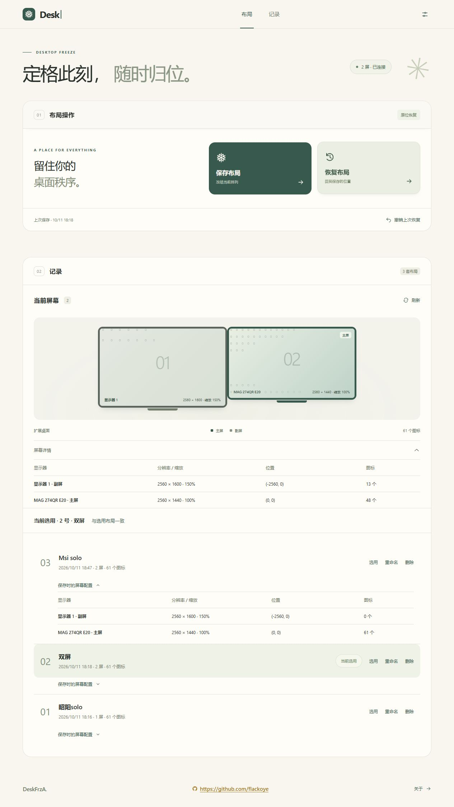

# DeskFrzA

**Desktop Freeze · 定格你的桌面。**

Windows 多屏桌面图标布局工具。使用 Windows Shell 官方接口读取和定位图标，记录各屏幕的设备身份、主屏角色、物理像素范围和缩放比例。

当前版本：**0.1.14 预览版**。已有真实的保存与恢复功能，尚未完成各种硬件配置的发布验收。



## 下载

普通用户无需克隆源码仓库：

- [下载 Windows 安装版](https://github.com/flackoye/DeskFrzA/releases/latest/download/DeskFrzA-Setup.exe)
- [下载 Windows 便携版](https://github.com/flackoye/DeskFrzA/releases/latest/download/DeskFrzA-Portable-win-x64.zip)
- [所有 Releases](https://github.com/flackoye/DeskFrzA/releases)

安装版支持许可确认、选择目录、可选桌面快捷方式及卸载；便携版解压后运行 `DeskFrzA.exe`。卸载保留布局与设置。

以上链接按 `flackoye/DeskFrzA` 预置，需要先创建对应仓库并发布 Release；当前源码中的链接不代表已经发布。若使用其他仓库名，请更新这三个链接。标记为预发布的版本可能不会被 `/releases/latest` 选中，请从“所有 Releases”下载。

仓库的 **Code → Download ZIP** 和 `git clone` 提供源码，需要自行编译，源码仓库不包含生成的 EXE。

## 使用

Windows 10 1703+ / Windows 11，当前交付为 x64。解压便携包后运行 `DeskFrzA.exe`。

- 首次使用先选择或保存一套 **默认单屏布局**。已有单屏记录可直接选用；图标集中在一块屏幕的旧多屏记录可复制为单屏模板，原记录保留。
- 记录分为 **单屏布局 / 多屏布局**。单屏布局可保存多套，默认项只有一套；更换默认项后才能删除旧默认项。
- 只剩一块启用的显示器，配置稳定两秒后自动恢复默认单屏布局；启动时已经是单屏也会执行一次。恢复后可继续手动整理，不会每两秒覆盖图标。
- 多屏状态下确认排列后，点击 **保存布局**；单屏模板可通过记录区的 **保存单屏布局** 单独保存。
- 点击 **恢复布局**，预检通过后确认恢复。
- 恢复前自动备份，支持 **撤销上次恢复**。
- 所有保存记录直接列出，支持选用、重命名和删除；单屏、多屏各自从 01 连续编号，删除后只重排所属分组。
- 记录可展开保存时的屏幕配置；桌面改变后询问是否另存新记录。
- 点击记录中的 **迁移**，把图标集中在一屏的布局整体移到当前主屏；先预览，确认后执行。
- 应用运行期间记录切换前的布局；主屏变化后直接预览迁移。切换前图标分布在多屏时警告，可保留更改或撤销切换。
- 层间距默认 48px，可从设置调整到 24–96px。

便携包包含 .NET 8.0.31 运行时。仍需 Microsoft Edge WebView2 Runtime；Windows 11 通常已安装。缺少时请从 [微软官方页面](https://developer.microsoft.com/en-us/microsoft-edge/webview2/) 安装。

拔屏保护需要应用运行；关闭应用期间不会操作桌面，再次打开后会检测单屏并恢复默认布局。不会修改 Windows 主屏、显示缩放、图标大小或网格设置；自动排列、容量不足或实际落位失败时提示原因，保留恢复前备份，可重新恢复或撤销。

布局与设置保存在 `%LOCALAPPDATA%\DeskFrz\library.json`。布局数据留在本机，不上传，不读取桌面文件内容。检查更新只访问公开的 GitHub Release 信息和下载文件。程序不需要管理员权限。关闭窗口会停止本地服务。

## 恢复规则

| 情况 | 行为 |
| --- | --- |
| 屏幕及图标配置相同 | 按原坐标恢复 |
| 同一批显示器，排列或主屏改变 | 按显示器设备身份匹配，图标跟随原屏幕 |
| 分辨率、缩放、方向或图标尺寸改变 | 优先保留网格行列；放不下时按原有列优先顺序重新排列 |
| 新图标 | 尽量保持原位；与旧图标冲突时，移到同屏最近的可用网格位置 |
| 已删除的图标 | 跳过，不创建文件 |
| 单块屏幕容量不足 | 整次预检失败，不移动图标 |
| 默认单屏布局，只剩一块屏幕 | 恢复到唯一屏幕；原设备不在时按剩余屏幕尺寸适配，空间不足则暂停 |
| 显示器组合不同或身份不明确 | 按原屏恢复仍暂停；可明确选择目标屏幕后迁移 |
| 自动排列开启 | 提示，由用户点击关闭；保留对齐网格设置 |
| 复制显示模式 | 暂停恢复，要求切换为扩展模式 |

每次保存保留一套布局。普通恢复继续按显示器身份匹配。迁移只支持图标集中在一个屏幕的布局：先整体平移，保持原间距与相对位置，不按 DPI 分别拉伸两轴，不为个别图标寻找空位。放不下时预览整体等比例缩小，经用户确认后执行；缩小后仍重叠或越界则暂停。新增图标原位保留，冲突则暂停。应用运行时保留切换前现场，无需先建记录；未运行期间的现场无法追溯。“撤销切换”只在原显示器全部仍连接且应用持有切换前配置时提供，恢复原主屏与布局。恢复前保留备份，失败明确提示。

预检后如果桌面项目或屏幕发生变化，会拒绝执行过期计划，要求重新预检。备份先持久写入，再调用 Shell 定位接口。调用后读取位置核对；发现未按计划落位时显示失败并保留备份，不宣称成功。撤销恢复到自动备份中的排列。

## 界面

象牙白主体、低饱和鼠尾草与松绿。通栏布局操作和记录面板；当前屏幕放在记录顶部，下方列出全部布局。正常滚动时标题栏逐层吸顶，下一层接替上一层；详细信息放入折叠区和弹窗。

## 开发

需要 .NET 8 SDK，首次还原依赖需要访问 NuGet。前端使用原生 HTML/CSS/JavaScript，无 Node 构建依赖。

```powershell
dotnet build DeskFrz/DeskFrz.csproj
dotnet run --project DeskFrz/DeskFrz.csproj
```

核心验证（不会移动桌面图标）：

```powershell
dotnet run --project DeskFrz/DeskFrz.csproj -- --selftest --data ./artifacts/tests
dotnet run --project DeskFrz/DeskFrz.csproj -- --probe --output ./artifacts/desktop.json
```

导出文件的父目录需要事先存在。`--probe` 包含项目路径和布局，应作为个人数据保留，不上传到 GitHub。

浏览器开发模式（本地真实桌面数据）：

```powershell
dotnet run --project DeskFrz/DeskFrz.csproj -- --serve --port 53741 --data ./artifacts/dev-data
```

打开 `http://127.0.0.1:53741`；结束进程停止服务。数据目录独立，不覆盖默认记录。API 只监听回环地址，写操作使用随机会话令牌，并检查 Host、Origin 和跨站请求。

## 构建安装包与发布

安装 [.NET 8 SDK](https://dotnet.microsoft.com/download/dotnet/8.0) 和 [Inno Setup 6.5+](https://jrsoftware.org/isdl.php)。在项目根目录运行：

```powershell
./scripts/package.ps1
# 自定义编译器路径：
./scripts/package.ps1 -Iscc 'C:\Program Files (x86)\Inno Setup 6\ISCC.exe'
```

`releases/` 将生成：

- `DeskFrzA-Setup.exe`：安装向导。
- `DeskFrzA-Portable-win-x64.zip`：便携包。
- `SHA256SUMS.txt`：下载校验。

发布脚本重新编译应用，并附带 .NET 与 WebView2 的许可文件。个人布局、测试产物和编译工具不会打包。

GitHub Actions 在提交或 PR 时构建并提供可下载的构建产物。推送 `v0.1.14` 这样的标签后，会生成一个 **Release 草稿**并附上安装版、便携版与校验文件；标签必须与 `DeskFrz.csproj` 的 `Version` 一致。检查草稿后点击 **Publish release**，README 下载入口才可用。也可以在 Releases 页面手动创建版本并上传这三个文件。

`.gitignore` 排除了构建目录、安装包、便携包、个人布局、会话文件及本地凭据；源码、图标、安装脚本和文档保留在仓库。

## 应用内更新

默认启动时及每六小时检查正式 Release；设置中可关闭自动检查，也可手动检查。发现新版本后顶部显示“有更新”。安装版支持下载、SHA256 校验及“安装并重启”，保留布局、设置和自定义数据目录；便携版提供下载页入口，由用户关闭应用后替换文件。

仅接受 `flackoye/DeskFrzA` 的公开正式版本，不自动安装草稿或预发布。每个 Release 必须附带 `DeskFrzA-Setup.exe` 和 `SHA256SUMS.txt`（打包脚本自动生成）。下载后和安装前各校验一次，损坏时可重新下载。无正式 Release、断网或 GitHub 限流时不会中断桌面操作；手动检查会显示原因。首次公开发布前，需要通过真实 Release 完成联网升级验收。

## 验证范围

详见 [docs/VALIDATION.md](docs/VALIDATION.md)。尤其需要继续验证真实硬件下的主屏切换、插拔、分辨率和缩放变化，以及副屏已有图标的恢复。纯算法测试不能替代这些硬件验收。

显示器使用 Windows 提供的设备路径匹配。更换接口、扩展坞或显卡后，路径可能变化；按原屏恢复会暂停，用户可明确选择目标屏幕后迁移。重命名文件会改变匹配身份，按新增/删除处理。

公开发布前应迁移到 .NET 10 LTS；[.NET 8 支持周期](https://dotnet.microsoft.com/en-us/platform/support/policy/dotnet-core)将在 2026-11-10 结束。本轮使用本机已有 .NET 8 SDK构建，并将便携运行时更新到官方当前补丁版本。

## 官方参考

- [多屏枚举](https://learn.microsoft.com/en-us/windows/win32/api/winuser/nf-winuser-enumdisplaymonitors)
- [显示器配置与身份](https://learn.microsoft.com/en-us/windows/win32/api/winuser/nf-winuser-querydisplayconfig)
- [微软桌面图标位置示例](https://devblogs.microsoft.com/oldnewthing/20130318-00/?p=4933)
- [使用受支持接口操作桌面图标](https://devblogs.microsoft.com/oldnewthing/20211122-00/?p=105948)

## 许可

MIT，见 [LICENSE](LICENSE)。WebView2 由 Microsoft 提供，其依赖许可由对应包说明。

记录区直接列出全部布局，支持连续编号、选用、重命名、删除。当前屏幕位于记录区顶部；桌面变化后询问是否加入新记录，原布局保留。
