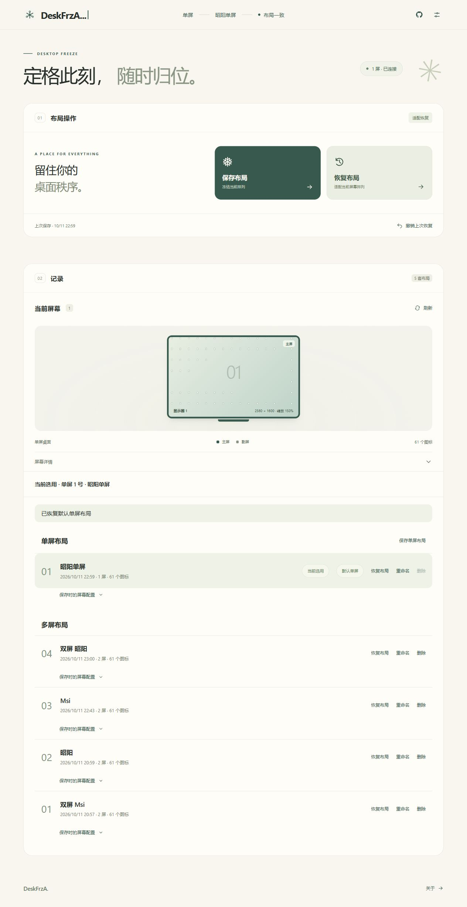

# DeskFrzA

**Freeze the moment, restore in place.**  
A modern, minimalist Windows desktop icon layout manager built for single and multi-monitor workflows.

[**中文**](README.md) | [**English**](README_EN.md)

[-blue)](https://github.com/flackoye/DeskFrzA/releases)

[**Download Installer**](https://github.com/flackoye/DeskFrzA/releases/latest/download/DeskFrzA-Setup.exe) · [**Download Portable**](https://github.com/flackoye/DeskFrzA/releases/latest/download/DeskFrzA-Portable-win-x64.zip) · [**All Releases**](https://github.com/flackoye/DeskFrzA/releases)

---

## Why DeskFrzA?

Docking and undocking laptops, switching primary monitors, or changing display scaling often scrambles carefully arranged desktop icons.

Inspired by classic utilities like DesktopOK, **DeskFrzA** focuses on doing just one thing well—saving and restoring your desktop icon layouts—with a clean interface and smart multi-monitor awareness:

- 🧊 **One-Click Freeze & Restore**: Save your icon arrangement anytime and restore it instantly when Windows messes it up.
- 🖥️ **Multi-Monitor Aware**: Organizes layouts into Single-Screen and Multi-Screen groups. Supports **cross-screen migration preview** and proportional scaling when displays change.
- 💻 **Auto-Restore on Undock**: Automatically restores your **default single-screen layout** once external monitors are disconnected.
- 🛡️ **Safe & Reversible**: Keeps newly created desktop items without overwriting them; backs up automatically before every restore so you can **undo the last restore** anytime.
- 🍃 **Clean, Local & Lightweight**: No ads, no bloat, and zero telemetry. All layout data stays strictly on your local machine.

  

## Download

| Edition | Description | Link |
| :--- | :--- | :--- |
| **Installer (Setup)** | Custom install path, shortcuts, and built-in one-click updates | [DeskFrzA-Setup.exe](https://github.com/flackoye/DeskFrzA/releases/latest/download/DeskFrzA-Setup.exe) |
| **Portable (Zip)** | Extract and run `DeskFrzA.exe` directly, no installation required | [DeskFrzA-Portable-win-x64.zip](https://github.com/flackoye/DeskFrzA/releases/latest/download/DeskFrzA-Portable-win-x64.zip) |

> Note: Current version is **0.1.15 Preview**. For pre-release builds, please visit the [Releases page](https://github.com/flackoye/DeskFrzA/releases).

## Quick Start

1. **Set Default**: On first launch, choose or save a **Default Single-Screen Layout**.
2. **Save Layout**: Arrange your desktop icons and click **Save Layout**.
3. **Restore**: Pick any saved record and click **Restore Layout** (confirm the migration preview if restoring across different monitors).

## Good to Know

- **Requirements**: Windows 10 (1703+) / Windows 11 x64. Install the official [Microsoft WebView2 Runtime](https://developer.microsoft.com/en-us/microsoft-edge/webview2/) if prompted.
- **Auto-Restore**: Undock auto-restore works while the app is running, and also checks single-screen status upon launch.
- **Non-Intrusive**: Restoring layouts never alters your Windows primary display setting, DPI scaling, or icon size.
- **Data & Privacy**: Layouts are saved locally under `%LOCALAPPDATA%\DeskFrz` and are preserved on uninstall.

## Documentation & Development

- [Restore & Migration Rules (CN)](docs/RESTORE.md)
- [Build, Package & Update Guide (CN)](docs/DEVELOPMENT.md)
- [Validation Notes (CN)](docs/VALIDATION.md)

Built with .NET 8 and vanilla HTML/CSS/JS. Licensed under the [MIT License](LICENSE).
